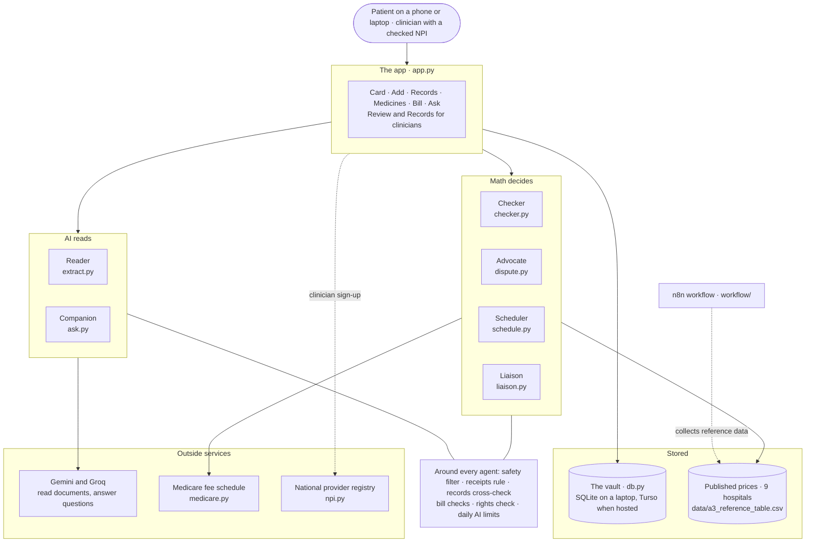
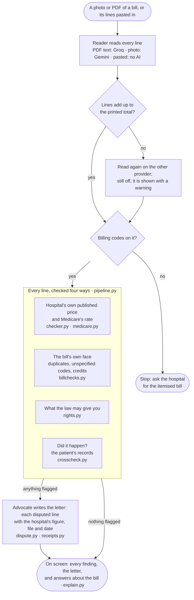
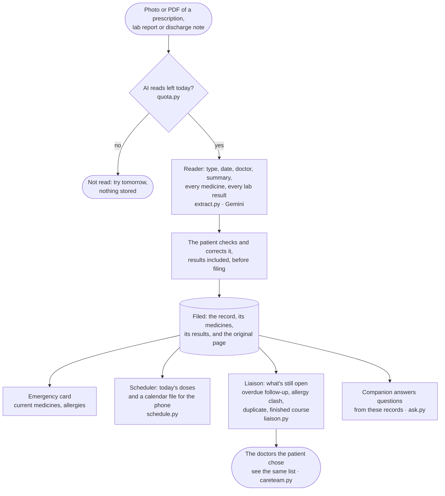
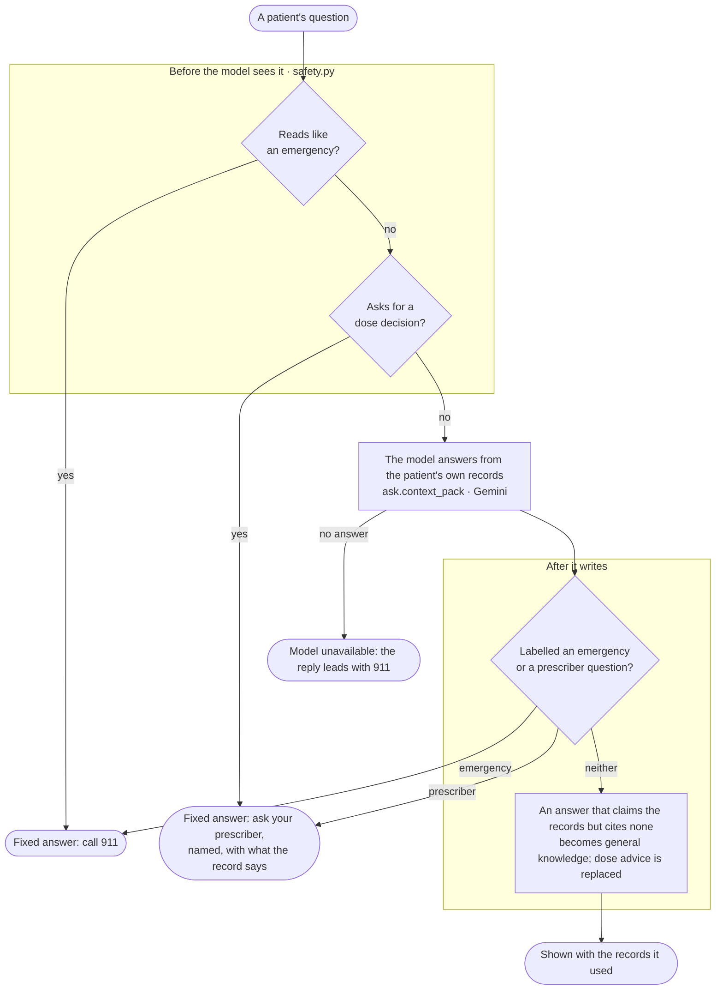
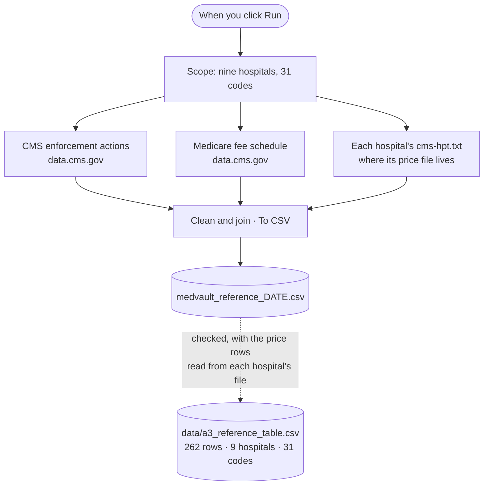
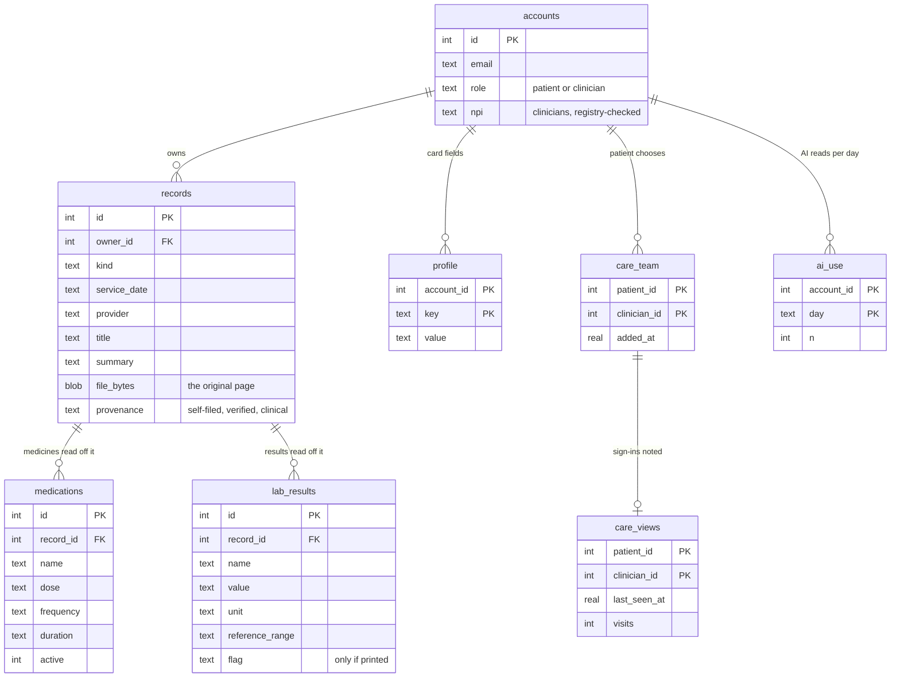

# How MedVault fits together

Six diagrams: the whole system, the two journeys a patient takes through it (a bill and a
record), the fence around the one bot that writes its own words, the workflow that collects
the reference data, and what the vault stores. GitHub draws them from the Mermaid source
below; every box names the file that does the work.

**The one rule under all of it: AI reads, math decides.** Only two agents call a model, the
Reader and the Companion. Every number a patient acts on, every warning and every letter is
computed in plain Python from a published file.

## 1. The system

## 2. Checking a bill

The journey behind slides 3 and 9 of the pitch: a photo or PDF in, a letter out, and a
question at every line the patient's own records cannot back.

## 3. Filing a record, and what comes of it

## 4. The fence around the Companion

The one agent that writes its own sentences. An emergency and a dose decision never get the
model's words, and every answer has to say where it came from.

Measured in `tools/safety_eval.py` on held-out questions written without access to this code:
103 of 103 emergencies get the 911 answer and 126 of 127 dose questions the prescriber answer,
with the patterns first and the model's label second.

## 5. Where the reference data comes from

`workflow/Nagaralu_Gurumurthy_Likhith_MedVault_Workflow.json` is an n8n workflow of nine
nodes. `workflow/run_without_n8n.mjs` runs the same code outside n8n, against the same
endpoints, so it can be checked before it is imported.

## 6. What the vault stores

`agent_runs` sits beside these: how long each agent took and whether it worked, and nothing
about whose run it was or what it read.

## Where each part lives

| Part | Files |
|---|---|
| Screens | `app.py`, `medvault/screen_*.py`, `medvault/ui.py`, `medvault/agentsui.py` |
| The six agents, as data | `medvault/agents.py` (Madison role, job, what it never does, time budget) |
| Reading documents | `medvault/extract.py`, `medvault/gemini.py`, `medvault/groq.py`, `medvault/pool_state.py` |
| Pricing a bill | `medvault/checker.py`, `medvault/medicare.py`, `medvault/billchecks.py`, `medvault/pipeline.py` |
| The letter and its sources | `medvault/dispute.py`, `medvault/receipts.py`, `medvault/explain.py` |
| Records, rights, safety | `medvault/crosscheck.py`, `medvault/rights.py`, `medvault/safety.py`, `medvault/ask.py` |
| Reminders and what's open | `medvault/schedule.py`, `medvault/liaison.py`, `medvault/careteam.py` |
| Accounts and storage | `medvault/accounts.py`, `medvault/npi.py`, `medvault/db.py`, `medvault/store.py`, `medvault/quota.py` |
| Reference data | `data/`, `workflow/` |
| Measurements | `tools/accuracy_test.py`, `tools/reader_eval.py`, `tools/safety_eval.py`, `tools/companion_eval.py`, `outputs/` |
| Tests | `tests/` (536) |
